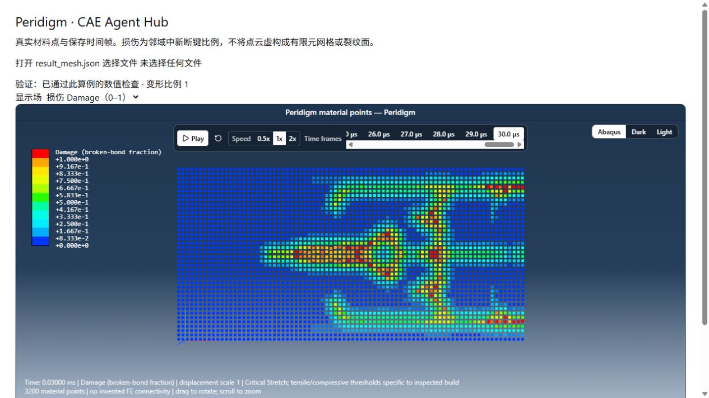

# Peridigm MCP · Agentic PD

本模块按 CAE-Agent-Hub 的分层组织初始 Agentic PD：渐进需求补全 → 确认并冻结 CaseSpec → PD规则检查 → 有时限的真实求解 → 独立结果验证 → 材料点展示。当前AI客户端负责理解与解释；CLI和12项STDIO MCP工具调用同一套确定性核心。

**状态：原型，两个限定模板已验证。** 当前不包含任意CAD生成、通用材料/损伤参数推断、工程认证或内置模型服务。参见[架构映射](ARCHITECTURE.md)、[完整Skill](../../Skill/peridigm/peridigm-evidence-fracture/SKILL.md)和[Demo来源](DEMO.md)。

## 先看Demo

在仓库 `viewer/` 中运行 `npm ci`、`npm run dev`，在输出的本地地址打开：

- `/peridigm.html?demo=elastic`：[弹性代码验证](../../models/peridigm-elastic)，2点、6个实际时刻，与gold及独立解析振子对照。
- `/peridigm.html?demo=fracture`：[预裂纹拉伸损伤演示](../../models/peridigm-notched-tension)，3,200点、31个真实展示时刻，逐步断键独立重建。

回放无需SSH、Peridigm或API密钥；静态构建也包含两份数据。页面明确标记已计算结果，支持播放/暂停、时刻选择、Damage/位移切换、实际曲线、验证摘要及边界。本页不会提交新求解。



## 已验证的物理模板

| 模板 | 执行范围 | 验证结果 | 适用边界 |
| --- | --- | --- | --- |
| `compression-two-point-v1` | MPI1/2，2点，6帧 | 与源码gold的位移/速度/力/膨胀率差0；独立解析位移误差0.2427% <0.5% | 合成弹性代码验证；不是收敛三维试件或断裂预测 |
| `notched-tension-damage-v1` | MPI1，40×20×0.5mm单层，3,200点，601原生时刻 | 新断键6,661对，点Damage独立重建差0；连通前沿指标推进12.5mm | 合成参数演示；不是精确裂纹面、实验标定或空间收敛结果 |

裂纹模板可在选择时显式传 `time_step_variant: half`，确认25ns半步（原50ns）；新断键6,700对，最终前沿指标一致，共同时刻前沿指标最大差0.5mm。这是描述性敏感性复核，不是正式收敛结论。当前求解器构建要求分别提供拉伸与压缩临界伸长，不能直接套用上游的单阈值字段。详见[损伤验证参考](../../Skill/peridigm/peridigm-evidence-fracture/references/fracture.md)。

## 配置真实求解

需要Linux上已有的兼容Peridigm/MPI及Python3.10+。在仓库外建立独立环境，安装模块：

```sh
python3 -m venv /path/to/agentic-pd/runtime/venv
/path/to/agentic-pd/runtime/venv/bin/python -m pip install -e './MCP/Peridigm[dev]'
```

若系统缺ensurepip，只在独立环境内用官方PyPA get-pip引导，不做全局安装。将[配置示例](config.example.json)复制到仓库外，填写独立项目根目录、求解器、匹配的MPI和已有依赖库路径。弹性验证还需把原源码 `test/verification/Compression_2x1x1/Compression_2x1x1_gold.e` 复制到外部runtime参考路径。仅为本项目设置 `PERIDIGM_CONFIG=/path/to/project/config/local.json`；依赖库变量只作用于求解子进程，不改原软件或全局环境。

## 实际工作流

在模块目录中用独立Python执行 `pd.py`：先doctor和templates，再start；answer选择模板后会返回全部参数与确认摘要。审阅后另一次answer确认精确摘要，再validate、submit、status、log、report。完整可复制命令见[英文README](README.md#cli-and-mcp)。

记录真实操作者身份，人、AI代理和脚本不能混写。规格冻结后不接受未审阅的物理覆盖；每个run只提交一次。repair只从不变的确认规格恢复输入/网格，保留原文件和diff，最多三次，不通过调整损伤、材料、约束、载荷或目标时间来凑成功。作业时限1–300秒，取消只针对本项目记录的作业。

MCP入口为 `python server.py`。[本地客户端示例](client.example.json)和[SSH示例](client.ssh.example.json)均使用占位符，需要用户自行填实际位置；模块不会注册或修改全局客户端配置。

| 工具 | 用途 |
| --- | --- |
| `peridigm_doctor / peridigm_templates` | Inspect dependencies and reviewed profiles / 检查依赖与模板 |
| `peridigm_start_context / peridigm_answer_context` | Ask for missing context, review parameters, confirm exact specification / 补全上下文、审阅并确认规格 |
| `peridigm_validate / peridigm_repair` | PD and identity gates; at most three canonical restorations / 规则检查，最多三次受限恢复 |
| `peridigm_submit / peridigm_status` | Detached bounded solve and persistent state / 后台求解与持久状态 |
| `peridigm_log / peridigm_cancel` | Inspect evidence; cancel only the recorded owned job / 日志及限定作业取消 |
| `peridigm_collect / peridigm_report` | Independent verification, material-point export and report / 独立验证、导出与报告 |

## 复现与检查

`python -m pytest -q` 和 `python scripts/check_demos.py` 不需要求解器。未提供项目配置时，单元测试使用隔离的身份校验数据，不把它当作物理参考；真实求解证据由Demo来源和运行记录单独说明。

配置好求解器后，`scripts/protocol_smoke.py` 测试实际STDIO初始化/工具发现/调用；`scripts/integration_mpi.py` 经MCP运行弹性MPI2；`scripts/integration_fracture.py base` 或 `half` 经MCP运行真实小裂纹算例。脚本如实记录测试身份并创建新run。`scripts/export_demo.py` 仅从已验证运行导出新的精选公开回放目录，细节见[DEMO.md](DEMO.md)。

## 文件与证据

`core.py`：共享上下文、输入、检查、作业状态；`pd.py`/`server.py`：CLI/MCP入口；`fracture.py`：损伤模板及断键重建；`postprocess.py`：弹性解析/参考对照和MPI合并；examples、rules、tests、scripts及完整Skill作为可复用源码一起维护。[四组评测协议](benchmarks/protocol.json)用于后续研究，尚未开展正式模型比较，不能据此宣称Agent性能提升。

独立runs目录保留请求/问答及真实身份、冻结规格、输入/网格、运行状态、求解器和结果摘要、日志、受限修复差异、原生Exodus、CSV、验证JSON、材料点导出与HTML报告。没有的数据明确标记未验证；不虚构有限元单元、裂纹面或应力场。

尚无完整能量/功平衡、断裂能标定、任意材料/几何、实验精度、空间收敛或MPI裂纹结论。原生大结果、私人配置/请求、环境和求解器不进仓库；经过明确整理的公开Demo为例外。保留[来源与许可证](THIRD_PARTY_NOTICES.md)。
