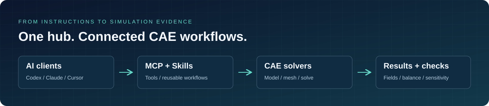
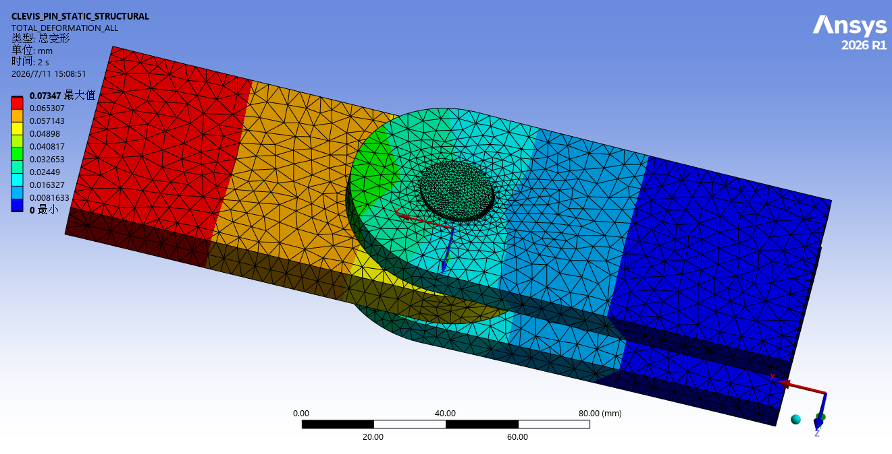
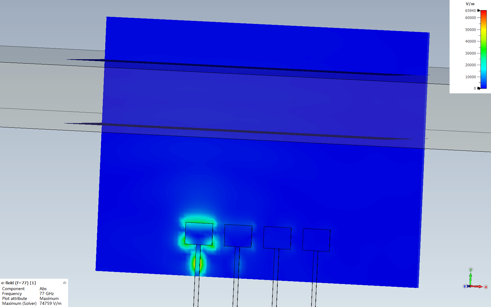
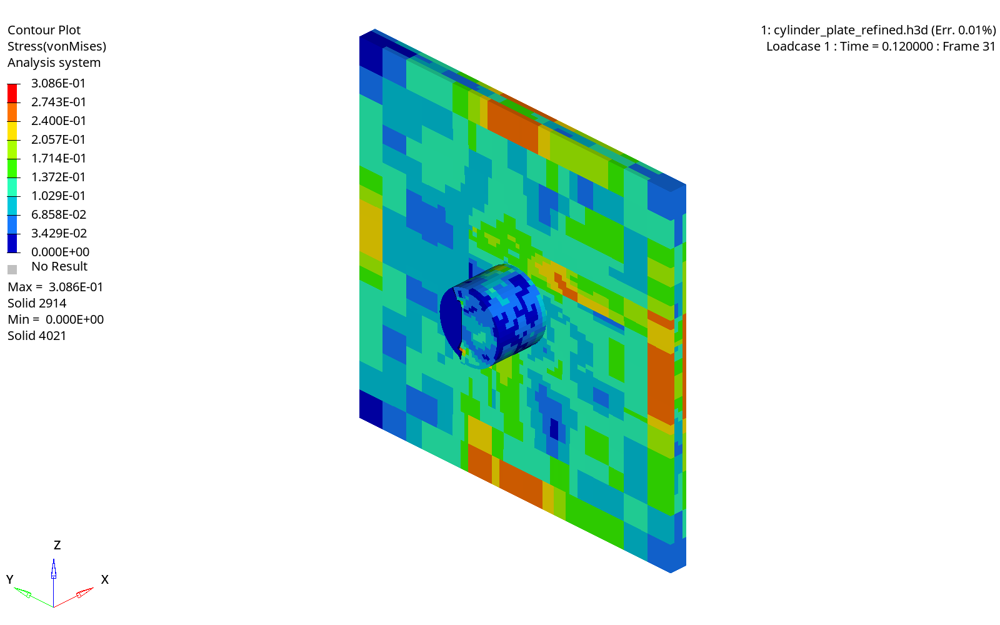

# CAE Agent Hub

<p align="center"><strong>让 AI 连接真实 CAE，让仿真留下可核查的证据。</strong></p>
<p align="center"><a href="README.md">English</a> · <strong>简体中文</strong></p>



面向工程仿真的 **MCP 工具、可复用 Skills 与结果查看器**。连接 Codex、Claude Code、Claude Desktop、Cursor 等客户端，将建模、网格、求解、后处理与校核串成可追溯的工作流。

[结果展示](#simulation-gallery) · [工具导航](#tool-index) · [快速开始](#quick-start) · [结果查看器](#text-to-cae-viewer)

另提供 [Subagent](Subagent/) 资源及 [Agentic PD](MCP/Peridigm) 工作流与已归档回放示例。

<a id="simulation-gallery"></a>

## 代表性仿真结果

为已有可核实结果的软件模块各选一个代表案例；暂无合适结果的模块暂不展示。点击图片查看大图；更多工况、校核图和来源记录见[完整图集](docs/simulation-atlas.md)。

<table>
<tr>
<td width="50%" valign="top">
<a href="assets/readme/frame-result.png"></a><br>
<strong>Abaqus · 框架动力学</strong><br>
20/30 kN脉冲响应；原生ODB位移云图，变形放大300倍。<br>
<a href="docs/simulation-atlas.md#frame">案例与来源 →</a>
</td>
<td width="50%" valign="top">
<a href="assets/readme/mechanical-clevis-deformation.png"></a><br>
<strong>Workbench / Mechanical · 耳板销轴接触</strong><br>
30 kN静力接触；M3总变形云图，三档网格位移对比。<br>
<a href="docs/simulation-atlas.md#mechanical-clevis">案例与来源 →</a>
</td>
</tr>
<tr>
<td width="50%" valign="top">
<a href="assets/readme/elbow-result.png"></a><br>
<strong>Fluent · 弯管层流</strong><br>
Re≈498；细网格全管静压降2.93381 Pa。<br>
<a href="docs/simulation-atlas.md#elbow">案例与来源 →</a>
</td>
<td width="50%" valign="top">
<a href="assets/readme/heatsink-result.png"></a><br>
<strong>COMSOL · 散热片传热</strong><br>
30 W细网格最高温度80.403 °C；两级网格与热平衡核查。<br>
<a href="docs/simulation-atlas.md#heatsink">案例与来源 →</a>
</td>
</tr>
<tr>
<td width="50%" valign="top">
<a href="assets/readme/maxwell--B_midplane_30.png"></a><br>
<strong>AEDT / Maxwell · 电磁执行器</strong><br>
四角度静磁扫描；展示磁场、转矩与电感结果。<br>
<a href="docs/simulation-atlas.md#maxwell">案例与来源 →</a>
</td>
<td width="50%" valign="top">
<a href="assets/readme/cst-radar77-field.png"></a><br>
<strong>CST · 77 GHz雷达阵列电场</strong><br>
端口1激励；原生电场幅值云图（V/m），时域六面体求解。<br>
<a href="docs/simulation-atlas.md#cst-radar77">案例与来源 →</a>
</td>
</tr>
<tr>
<td width="50%" valign="top">
<a href="assets/readme/bracket-hex--235_fine_mises_average75.png"></a><br>
<strong>ANSA → Abaqus · 全六面体支架</strong><br>
原生前处理与1000 N静力求解；保留网格及应力校核。<br>
<a href="docs/simulation-atlas.md#bracket-hex">案例与来源 →</a>
</td>
<td width="50%" valign="top">
<a href="assets/readme/radioss-cylinder-impact.png"></a><br>
<strong>HyperWorks / Radioss · 圆柱冲击钢板</strong><br>
0.12 ms末帧Mises应力（GPa）；能量误差与适用范围见案例。<br>
<a href="docs/simulation-atlas.md#radioss-cylinder">案例与来源 →</a>
</td>
</tr>
</table>

图像类型、单位、显示倍率及验证范围见各案例说明；工程应用需由对应专业工程师复核。

<a id="tool-index"></a>

## 工具与工作流导航

按软件选择适配器；各目录的 README 说明安装、客户端配置与限制。下表为源码入口索引，实际可用性取决于本地软件、版本、许可证和桥接状态。

| 软件 / 工具链 | 工作流入口 |
| --- | --- |
| [Abaqus](MCP/Abaqus) | CAE内核脚本、任务提交、ODB与视口后处理 |
| [Fluent](MCP/Ansys/Fluent%20MCP) | 批处理journal、作业日志与PyFluent会话 |
| [Workbench / Mechanical](MCP/Ansys/Workbench%20MCP) | Workbench自动化与Mechanical ACT桥接 |
| [AEDT](MCP/Ansys/AEDT%20MCP) | Electronics Desktop工程与电磁自动化 |
| [COMSOL](MCP/COMSOL) | 多物理场模型、参数、求解与结果导出 |
| [CST Studio Suite](MCP/CST) | 电磁建模、求解、1D结果与Touchstone导出 |
| [HyperWorks](MCP/HyperWorks) | HyperMesh会话、实体检查与求解任务管理 |
| [CalculiX](MCP/CalculiX) | 开源有限元、模态分析与尺寸优化 |
| [LAMMPS](MCP/LAMMPS) | 分子动力学输入执行与作业证据 |
| [OVITO](MCP/OVITO) | 原子尺度脚本后处理与可视化 |
| [FreeCAD → Elmer → ParaView](MCP/FEP-Agent-Hub) | 开源建模、网格、求解与后处理链路 |
| [PyAnsys MCP collection](MCP/Ansys/PyAnsys) | 各PyAnsys专用适配器及其独立说明 |
| [Adams](MCP/Adams/README.zh-CN.md) | 刚体机构与有界批处理；原生数值检查通过，live连接尚未验证（[验证记录](MCP/Adams/VALIDATION.md)） |
| [Peridigm](MCP/Peridigm) | 原型；限定模板已验证的近场动力学与损伤结果回放 |

**Skills：** [完整索引](Skill/README.zh-CN.md) · [Abaqus分析流程](Skill/abaqus/README.zh-CN.md) · [Ansys结构工作流](Skill/Ansys/ansys-structural-workbench) · [通用圆柱O-grid](Skill/General/cylinder-o-grid)

<details>
<summary>展开完整 Skill 明细</summary>

- [adams-evidence-mbd](Skill/Adams/adams-evidence-mbd/SKILL.md)：刚体机构建模、
  View 瞬态批处理和数值反力证据检查。

| Skill | 状态 | 用途 | 触发关键词 |
| --- | --- | --- | --- |
| [abaqus](Skill/abaqus/core/abaqus) | Active | Abaqus FEA 脚本和分析工作流的总控路由 skill。 | Abaqus, FEA, finite element, simulation |
| [abaqus-geometry](Skill/abaqus/modeling/abaqus-geometry) | Active | 创建 part、sketch、extrusion、assembly，并导入 CAD。 | geometry, part, sketch, STEP, IGES |
| [abaqus-material](Skill/abaqus/modeling/abaqus-material) | Active | 定义材料、section、密度、弹性、塑性和常用工程材料参数。 | material, steel, aluminum, Young's modulus |
| [abaqus-mesh](Skill/abaqus/modeling/abaqus-mesh) | Active | 生成有限元网格并选择元素类型。 | mesh, elements, nodes, C3D8R |
| [abaqus-interaction](Skill/abaqus/modeling/abaqus-interaction) | Active | 定义接触、摩擦、tie、connector 和 bonded surface。 | contact, friction, tie, bonded |
| [abaqus-amplitude](Skill/abaqus/setup/abaqus-amplitude) | Active | 定义 ramp、pulse、cyclic、transient 等随时间变化的 amplitude。 | amplitude, ramp, pulse, cyclic |
| [abaqus-bc](Skill/abaqus/setup/abaqus-bc) | Active | 定义 fixed、pinned、clamped、displacement、symmetry 等边界条件。 | fixed, clamped, pinned, support |
| [abaqus-docs](Skill/abaqus/setup/abaqus-docs) | Active | 下载和管理 abqpy / Abaqus API 文档。 | Abaqus docs, API reference, abqpy |
| [abaqus-field](Skill/abaqus/setup/abaqus-field) | Active | 定义 initial condition 和 predefined field，例如初始温度、残余应力。 | initial condition, predefined field |
| [abaqus-load](Skill/abaqus/setup/abaqus-load) | Active | 施加集中力、压力、重力和分布载荷。 | force, pressure, gravity, load |
| [abaqus-output](Skill/abaqus/setup/abaqus-output) | Active | 配置 field output 和 history output 请求。 | output request, field output, history output |
| [abaqus-step](Skill/abaqus/setup/abaqus-step) | Active | 定义 analysis step、procedure、increment、time period 和 nlgeom 设置。 | step, static step, dynamic step, nlgeom |
| [abaqus-static-analysis](Skill/abaqus/analysis/abaqus-static-analysis) | Active | 静力结构分析完整工作流，用于应力、位移、反力、强度和刚度评估。 | static, stress, displacement, strength |
| [abaqus-modal-analysis](Skill/abaqus/analysis/abaqus-modal-analysis) | Active | 提取固有频率和振型，用于振动和共振检查。 | modal, frequency, vibration, resonance |
| [abaqus-dynamic-analysis](Skill/abaqus/analysis/abaqus-dynamic-analysis) | Active | 动力学完整工作流，用于 impact、crash、drop test、transient、显式/隐式动力学。 | impact, crash, drop test, explicit |
| [abaqus-thermal-analysis](Skill/abaqus/analysis/abaqus-thermal-analysis) | Active | 稳态或瞬态热传导分析工作流。 | thermal, heat transfer, conduction |
| [abaqus-coupled-analysis](Skill/abaqus/analysis/abaqus-coupled-analysis) | Active | 热-结构耦合分析，用于 thermal stress 和温度导致的变形。 | thermal stress, expansion, deformation |
| [abaqus-contact-analysis](Skill/abaqus/analysis/abaqus-contact-analysis) | Active | 多体接触分析，用于摩擦、过盈配合、螺栓和装配接触。 | contact analysis, friction, press fit |
| [abaqus-fatigue-analysis](Skill/abaqus/analysis/abaqus-fatigue-analysis) | Active | 疲劳和耐久性工作流，用于循环、损伤累计和寿命预测。 | fatigue, durability, cycles |
| [abaqus-job](Skill/abaqus/execution/abaqus-job) | Active | 创建、提交、监控和管理 Abaqus job 与 input file。 | submit job, input file, execute |
| [abaqus-export](Skill/abaqus/execution/abaqus-export) | Active | 导出 Abaqus 几何和结果到 STL、STEP、CSV、INP 或外部格式。 | export, STL, STEP, CSV, INP |
| [abaqus-odb](Skill/abaqus/postprocessing/abaqus-odb) | Active | 读取 ODB 结果并提取应力、位移、反力和结果摘要。 | ODB, maximum stress, displacement |
| [abaqus-optimization](Skill/abaqus/optimization/abaqus-optimization) | Active | 配置 Tosca optimization 的 response、objective、constraint 和 SIMP 类参数。 | optimization, objective, Tosca |
| [abaqus-shape-optimization](Skill/abaqus/optimization/abaqus-shape-optimization) | Active | 优化 fillet、notch 或 surface shape，降低峰值应力，不做拓扑删减。 | shape optimization, fillet, notch |
| [abaqus-topology-optimization](Skill/abaqus/optimization/abaqus-topology-optimization) | Active | 拓扑优化工作流，在保持刚度的同时减少质量。 | topology optimization, weight reduction |
| [fea-structural](Skill/abaqus/reference/fea-structural) | Reference | 通用结构有限元参考，覆盖静力、动力、非线性和验证。 | structural FEA, nonlinear, validation |
| [fenics-fem](Skill/abaqus/reference/fenics-fem) | Reference | FEniCS/dolfinx 有限元参考，用于弱形式、gmsh 网格、PDE 和 ParaView 导出。 | FEniCS, dolfinx, PDE, gmsh |
| [lammps-evidence-md](Skill/lammps/lammps-evidence-md) | Active | 证据优先的 LAMMPS 分子动力学工作流。 | LAMMPS, 分子动力学, stress-strain |
| [ovito-evidence-postprocessing](Skill/ovito/ovito-evidence-postprocessing) | Active | 证据优先的 OVITO 原子尺度后处理工作流。 | OVITO, visualization, atomistic |
| [ansys-mechanical-evidence-structural](Skill/Ansys/ansys-mechanical-evidence-structural) | Active | 与 Workbench 主工作流互补的 Mechanical 证据和验收门槛。 | Mechanical, ACT, PyMechanical, MAPDL |
| [aedt-evidence-electromagnetics](Skill/Ansys/aedt-evidence-electromagnetics) | Active | 含 Maxwell 检查的泛用 AEDT 证据工作流。 | AEDT, Maxwell, HFSS, PyAEDT |
| [comsol-motor-nvh-evidence](Skill/comsol/comsol-motor-nvh-evidence) | Active | 检查点式永磁电机 NVH 工作流，耦合旋转电磁、结构模态、声学与 Campbell 验证。 | COMSOL, 电机 NVH, Maxwell 力, 模态, Campbell |
| [calculix-fem](Skill/calculix/calculix-fem) | Active | 驱动 CalculiX MCP 的工作流：检视 `.inp`、原位修改设计变量、运行 ccx、读取 `.dat` 结果、导出 `result_mesh.json`。 | CalculiX, FEM, ccx, .inp, 线性静力 |
| [calculix-sizing-optimization](Skill/calculix/calculix-sizing-optimization) | Active | 在 CalculiX 壳/梁 deck 上跑两阶段尺寸优化（LHS 粗扫 + 坐标下降），在应力/位移约束下最小化质量；模态 deck 上可用固有频率下限约束（避共振）。 | CalculiX, 尺寸优化, 减重, LHS, 坐标下降, 共振, 固有频率 |
| [calculix-modal-analysis](Skill/calculix/calculix-modal-analysis) | Active | 从 CalculiX `*FREQUENCY` 步提取固有频率与振型；第 N 阶可导出为 viewer 的无应力振型。 | CalculiX, 模态, 固有频率, 振型, 共振, 振动 |
| [peridigm-evidence-fracture](Skill/peridigm/peridigm-evidence-fracture) | 原型 · 限定模板已验证 | 渐进问答、物理规格冻结、受限修复、求解证据与损伤/裂纹解释。 | Peridigm, 近场动力学, Damage, 裂纹 |
| [fep-agent-hub](Skill/fep-agent-hub) | Active | FreeCAD → Elmer FEM → ParaView 证据优先总控 Skill，覆盖已验证 profile、物理门禁、敏感性检查与真实动画口径。 | FEP Agent Hub, FreeCAD, Elmer FEM, ParaView, CAE 验证 |

> 新增 skill 时，请保留完整 skill 目录，包括 `SKILL.md`、可用的 `metadata.json`、上游来源、references、assets 和工作流脚本。

</details>

<a id="quick-start"></a>

## 快速开始

### 克隆仓库

```powershell
git clone https://github.com/Cai-aa/CAE-Agent-Hub.git
Set-Location .\CAE-Agent-Hub
```

如果你之前克隆的是旧仓库名，GitHub redirect 通常仍然可用，但建议更新 remote：

```powershell
git remote set-url origin https://github.com/Cai-aa/CAE-Agent-Hub.git
```

### 使用 MCP server

每个适配器有自己的依赖和启动方式，请按上方软件链接打开对应 README。先安装相应 CAE 软件并确认许可证，再按该目录说明创建 Python 环境、安装依赖和注册 MCP；需要应用内插件的适配器还须安装桥接插件。

配置后，先做环境检测或只读模型查询，再执行示例算例。工程应使用独立输出目录，保留输入、求解日志和结果校核记录。

### 使用 skills

Skill 是 instruction module，不是求解器二进制文件。请复制完整 skill 目录到 agent 的 skill 目录，或把相关 `SKILL.md` 作为项目上下文。

Codex 示例：

```powershell
New-Item -ItemType Directory -Force -Path "$env:USERPROFILE\.codex\skills" | Out-Null
Copy-Item -Recurse -Force ".\Skill\abaqus\analysis\abaqus-static-analysis" "$env:USERPROFILE\.codex\skills\abaqus-static-analysis"
```

示例提示词：

```text
使用 abaqus-static-analysis、abaqus-mesh、abaqus-job 和 abaqus-odb skills。
先检查 Abaqus 环境并回读当前会话；在独立目录建立悬臂梁静力算例，
完成网格、求解、ODB 提取与力平衡检查，报告实际文件、命令和未完成项。
```

## Text to CAE Viewer

Viewer 仍作为浏览器结果检查层保留。只要案例包含 `result_mesh.json`，即使没有安装求解器也可以查看。

```powershell
Set-Location .\viewer
npm.cmd install
npm.cmd run dev
```

打开 Vite 输出的地址，通常是：

```text
http://127.0.0.1:4178/
```

### Agentic PD 真实结果回放

按上文启动Viewer后，打开 `/peridigm.html`，选择：

- `/peridigm.html?demo=elastic`：[弹性基准](models/peridigm-elastic)，6个真实时刻，含gold与独立解析解对照。
- `/peridigm.html?demo=fracture`：[预裂纹拉伸损伤演示](models/peridigm-notched-tension)，3,200材料点、31个真实展示帧、逐步断键独立重建。

回放不需要Peridigm或SSH；构建会携带两份数据，可用于静态展示。它们是已计算结果，不代表浏览器正在求解或已连接AI服务。重新求解使用 [CLI/MCP](MCP/Peridigm) 与 [Skill](Skill/peridigm/peridigm-evidence-fracture)。来源及能力边界见 [DEMO.md](MCP/Peridigm/DEMO.md)。

## 仓库结构

```text
CAE-Agent-Hub/
  MCP/
    Abaqus/
    CalculiX/
    Adams/
    Peridigm/
    COMSOL/
    CST/
    FEP-Agent-Hub/
    HyperWorks/
    LAMMPS/
    OVITO/
    Ansys/
      AEDT MCP/
      Fluent MCP/
      Workbench MCP/
      PyAnsys/
  Skill/
    calculix/
    abaqus/
      core/
      modeling/
      setup/
      analysis/
      execution/
      postprocessing/
      optimization/
      reference/
  Subagent/
  models/
  viewer/
  assets/readme/   # 精选结果图与来源记录
  docs/           # 算例说明与教程
```

## 源码管理规则

仓库应该包含可复用源码、文档、测试、示例、模板和 skill instruction。`models/peridigm-*` 是经过明确整理的公开回放样本，仅保留精选结果字段、验证摘要、规范输入及文件摘要，并标明来源和边界；完整原生作业及私人运行状态仍保存在仓库外。

仓库不应该包含：

- CAE 软件二进制文件或许可证。
- 私有机器路径或凭据。
- 虚拟环境和包缓存。
- 原始求解器输出，例如 ODB、case/data、AEDT results、Workbench project 和运行日志。
- 可以重新生成的大型本地结果文件。

精选文档插图可放入 `assets/readme/`，并记录来源、工况及适用范围。

## 构建

构建前端 viewer：

```powershell
Set-Location .\viewer
npm.cmd run build
```

## 路线图

这个 Hub 会继续扩展到更多主流仿真生态：

- 更多求解器专用 MCP server。
- 更多产品化 skill pack，用于可复用建模和验证工作流。
- 面向 viewer 和报告生成的共享结果导出格式。
- 每个 CAE 应用的安装提示词和验证脚本。

## Peridigm 开发模块

[Peridigm 模块](MCP/Peridigm/README.zh-CN.md)提供共享 CLI/MCP 核心、规格确认、受限修复及材料点展示。已验证范围包括两材料点弹性代码基准和合成预裂纹拉伸损伤演示；工程强度与实验精度仍未验证。参见[架构映射](MCP/Peridigm/ARCHITECTURE.md)与 [Skill](Skill/peridigm/peridigm-evidence-fracture/SKILL.md)。
