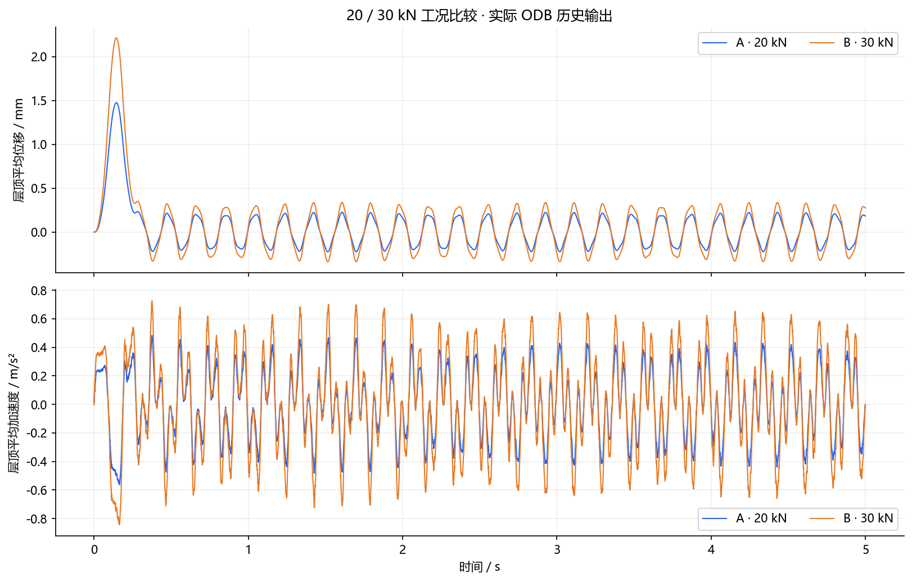
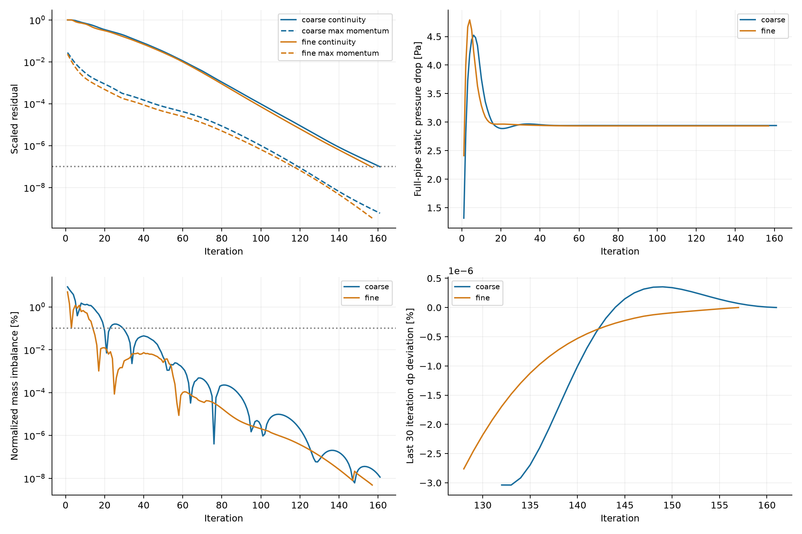

# 仿真结果与校核 / Simulation results and checks

[English homepage](../README.md) · [中文主页](../README.zh-CN.md)

[完整图集现已扩展，点击查看全部结果条目与图组](simulation-atlas.md)。本页保留首批四个历史算例的详细工况、结果含义和校核范围。结果图与校核图均从已有运行目录逐字节复制，未重绘、裁剪或改动色标。Fluent 场图本身是原运行中对导出场数据的本地插值绘图，其余三张主页场图为软件原生导出。

This page records the setup, result definitions, and validation scope behind four historical cases. The original eight PNGs on this page are byte-for-byte copies of existing run artifacts. The expanded atlas also includes explicitly labeled plots from saved numerical data. The Fluent field plot was locally interpolated from exported solver values during that run; the other three homepage field images are native application exports. Original labels may be in Chinese.

## 结果概览 / Selected results

| 算例 / Case | 日期 / Date | 工况与结果 / Setup and result | 已有校核 / Recorded checks |
| --- | --- | --- | --- |
| COMSOL heatsink | 2026-10-25 | 30 W, fine mesh; Tmax = 80.403111 °C | Four solves; heat balance; two meshes; 20 W / 30 W scaling |
| Mechanical cantilever | 2026-10-18 | 100 N end load; max total deformation = 0.79650984 mm | Three meshes; reactions; work–strain-energy consistency |
| Abaqus three-story frame | 2026-10-25 | 20 kN pulse; peak absolute mean roof displacement = 1.476251 mm | Six completed jobs; ODB readback; load scaling; mesh/time sensitivity |
| Fluent elbow | 2026-10-17 | Re = 497.607; fine-mesh full-pipe static drop = 2.93380994 Pa | Native convergence logs; mass balance; two meshes; integral monitors |

日期均为 Asia/Shanghai。这里整理已有记录，本次 README 更新未重新求解或确认软件当前会话状态。

Dates use Asia/Shanghai. This documentation update reviews saved records; it does not rerun the solvers or certify a currently connected session.

## 01 / COMSOL · 散热片 / Heatsink

基板 120 × 80 × 5 mm，7 个 3 × 70 × 25 mm 铝翅片；k = 167 W/(m·K)。底面均匀输入 20 W 或 30 W，其余外露面 h = 15 W/(m²·K)，环境 25 °C；稳态固体导热，无空气域、辐射或接触热阻。COMSOL 6.4 共享服务器完成两档网格、两档功率共四次求解。

An aluminum base and seven fins conduct heat from a uniform bottom heat input to surfaces with a prescribed convection coefficient. Ambient temperature is 25 °C. Four stationary solves cover two meshes and two powers; no air domain, radiation, or thermal contact resistance is modeled.

- 细网格 / Fine mesh: 915,663 tetrahedra; Tmax at 20 W / 30 W = 61.935407 / 80.403111 °C.
- 30 W 热平衡 / Heat balance: Qin = 30 W; Qout = 29.999991155 W; imbalance ≈ 0.000029483%.
- 20 W 粗细网格最高温升差 / Coarse–fine peak temperature-rise difference: ≈ 0.002408%.

**范围 / Scope:** 两级网格提供敏感性证据；常数 k、常数 h 的线性模型中，30 W / 20 W 的温升比为 1.5。实际风速、安装方向、接触和换热系数需由传热工程师确认。Two meshes provide sensitivity evidence. The 1.5 temperature-rise ratio applies to this constant-k, constant-h model; actual cooling performance requires review of convection, mounting, and interfaces.

## 02 / Mechanical · 悬臂梁 / Cantilever

200 × 20 × 10 mm 钢梁，E = 200,000 MPa、ν = 0.3；一端面固定，另一端面受全局 −Z 方向 100 N 合力。小变形线弹性，无重力、接触或弱弹簧；最终采用 2.5 mm SOLID186 二次六面体，2,560 个实体单元。

A 200 × 20 × 10 mm linear elastic steel beam is clamped at one end and loaded by a 100 N resultant on the other end face. The final mesh contains 2,560 SOLID186 quadratic hex elements; gravity, contact, and weak springs are absent.

- 最大总变形 / Maximum total deformation: 0.79650984 mm.
- 中档到细档总变形变化 / Medium-to-fine change: ≈ 0.02446%.
- 支反力 Z 分量 / Support reaction Z: 100.000000196 N.
- 外力做功与应变能 / External work and strain energy: 39.79669257 / 39.79669270 mJ.

**范围 / Scope:** 固定端全局峰值应力尚未获收敛认证。原日志保留两条同类 SURF154 材料提示，已通过实体能量和端面功积分复核整体一致性。变形图的显示形状不用于读取挠度，数值以色标和结果提取为准。Global peak clamp stress is not certified converged. Two SURF154 material warnings remain documented; solid-element energy and face-work integration support the global check. Displayed deformation geometry is illustrative; use extracted values and the legend for displacement. Structural design needs an engineer’s review of the real support and strength criteria.

## 03 / Abaqus · 三层框架 / Three-story frame

线弹性空间梁教学模型，无楼板附加质量、重力预载或物理阻尼。20 kN / 30 kN 脉冲工况分别保存独立 Job 与 ODB，分析时长 5 s；另有模态细网格、动力细网格与半时间步任务。已核对六项任务的完成记录与结果回读。

A linear elastic teaching beam frame is subjected to separate 20 kN and 30 kN pulse cases over 5 s. Six completed jobs cover modal and dynamic baselines plus mesh/time refinement. Added slab mass, gravity preload, and physical damping are absent.

- 20 kN / 30 kN 层顶最大绝对平均位移 / Peak absolute mean roof displacement: 1.476251 / 2.214376 mm.
- 位移比例 / Displacement ratio: ≈ 1.5; peak kinetic-energy ratio: ≈ 2.25.
- 主页云图 / Homepage contour: displacement magnitude in **m**, deformation scale **300×**, at the stored frame closest to the peak roof response. Its nodal maximum differs from the four-corner mean roof KPI.

**范围 / Scope:** 单次网格与时间步细化属于敏感性研究，长时加速度波形的严格收敛仍待验证。动态任务保留精确时刻输出相关的输入警告，无分析错误。该教学梁模型不能直接用于真实建筑安全评定。Single mesh/time refinements are sensitivity studies; strict long-time acceleration waveform convergence remains open. Dynamic jobs retain the predefined-time-point output warning and report no analysis errors. Real-building assessment requires a qualified structural engineer and a suitable model.

## 04 / Fluent · 90°弯管 / 90° elbow

内径 0.02 m，弯曲半径 0.06 m，入口/出口直段 0.6 / 0.4 m；20 °C 常物性水，均匀入口 0.025 m/s、出口表压 0 Pa、静止无滑移壁面。不可压缩稳态层流，Re = 497.607。五块共形 O-grid 扫掠全六面体，粗/细网格 61,440 / 207,360 单元。

Steady incompressible laminar water flow through a 20 mm diameter elbow with a 60 mm bend radius, uniform 0.025 m/s inlet velocity, zero-gauge-pressure outlet, and no-slip walls. Coarse and fine all-hex meshes have 61,440 and 207,360 cells.

- 细网格全管静压降 / Fine full-pipe static drop: 2.93380994 Pa; coarse-to-fine change ≈ 0.235%.
- 细网格质量不平衡 / Fine mass imbalance: ≈ 4.8623 × 10⁻⁹%.
- 两级原生日志均记录收敛 / Native convergence recorded at 161 / 157 iterations.

**范围 / Scope:** 全管静压降是入口减出口的面积平均静压，不能替代弯管不可逆局部损失系数。壁面峰值剪切应力粗细变化约 6.037%，两级网格不足以证明严格网格无关或可信 GCI。CFD 工程师需复核实际流态、入口和出口长度、局部峰值及实验对照。The reported static drop is an inlet-to-outlet area-average pressure difference. It is not an isolated elbow loss coefficient. Peak wall-shear sensitivity is about 6.037%; two meshes do not establish asymptotic independence or a reliable GCI.

## 图片来源与归档 / Image provenance

[provenance.json](../assets/readme/provenance.json) 记录八张图片的源运行相对路径、图片 SHA-256 以及对应源校核文件的 SHA-256，便于持有原始归档时核对。主页插图保留原始分辨率；未上传大型求解器结果或整个运行目录。

The manifest records original archive-relative paths, image hashes, and source-record hashes for matching against the original local archives. Those archives and full solver records are not bundled here; hashes establish correspondence when the originals are available and do not independently validate the physics. This page is a curated result summary, not a complete reproducibility package.

| 图片前缀 / Image prefix | 源归档目录 / Original archive directory | 核对记录 / Source record |
| --- | --- | --- |
| `heatsink-*` | `COMSOL_Heatsink_Analysis/rerun_20261025_1545/` | `06_validation/validation_summary.json`, `08_report/report.md` |
| `cantilever-*` | `workspace/cantilever_visible_20261018_1133/` | `review_20261018/audit_results.json`, review report |
| `frame-*` | `Abaqus_ThreeStory_Dynamics/rerun_20261025/` | `06_validation/KPI_comparison.json`, `job_diagnostics.json`, report |
| `elbow-*` | `runs/elbow90_water_20261017/` | `comparison.json`, `REPORT.md` |
